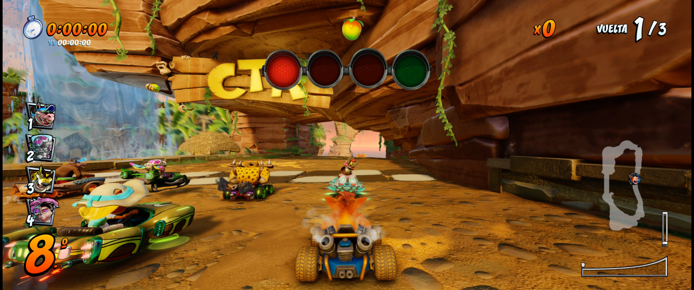
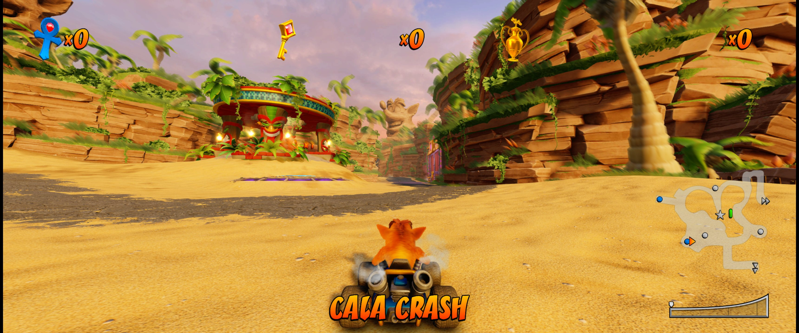
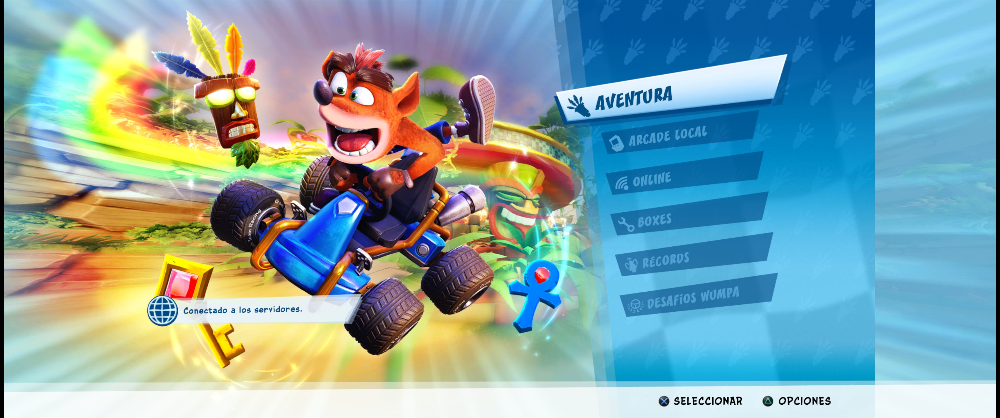
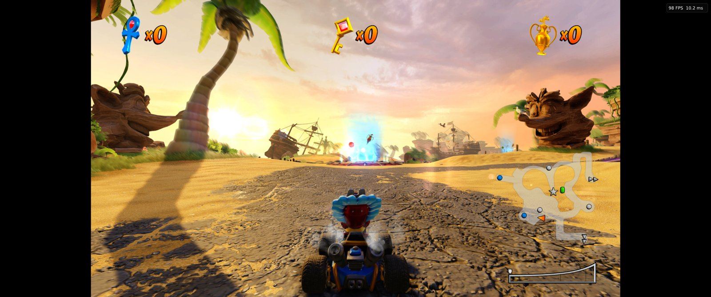

# CTR Nitro-Fueled PC — Ultrawide Mod

21:9 and 32:9 ultrawide support for the Crash Team Racing: Nitro-Fueled PC port (OCTR v0.5.2).

## [Download CTR-Ultrawide-mod-v1.1.zip](https://github.com/UrielLz/CTR-Ultrawide/raw/main/CTR-Ultrawide-mod-v1.1.zip)

34 MB · SHA-256 in [`CTR-Ultrawide-mod-v1.1.zip.sha256`](CTR-Ultrawide-mod-v1.1.zip.sha256)

Without the mod:

## Install

1. Close the game.
2. Extract the zip **into your port folder** and overwrite when asked.
3. Play. It adapts to your monitor automatically.

## Controls

- `Ctrl+Alt+H` or double-click **R3**: hide or show the HUD.
- **Insert** or **L3+R3** → HUD (ultrawide): edges, centered or stretched.

## Notes

- Requires the [OCTR-NitroFueled-PC v0.5.2](https://github.com/Ryu7w7/OCTR-NitroFueled-PC/releases/tag/v0.5.2) port. Works at 1080p, 1440p and 4K internal resolution (1440p recommended for 3440x1440).
- No game files included.
- To uninstall: extract the original port zip over it.

---

**Español:** cierra el juego, extrae el zip dentro de tu carpeta del port (OCTR v0.5.2) y juega. `Ctrl+Alt+H` o doble clic en R3 oculta el HUD.

Source: [UrielLz/OCTR-NitroFueled-PC](https://github.com/UrielLz/OCTR-NitroFueled-PC/tree/ultrawide-hud) · GPL-2.0-or-later · Based on the work of Ryu7w7, GetLostIn and T3CHNOLOG1C. Not affiliated with Activision or Beenox.
